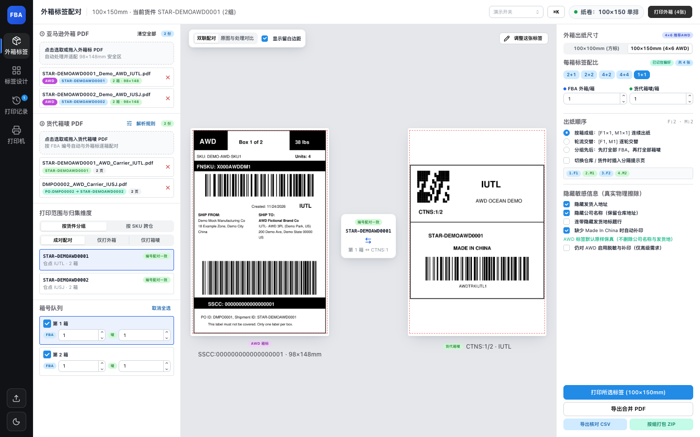
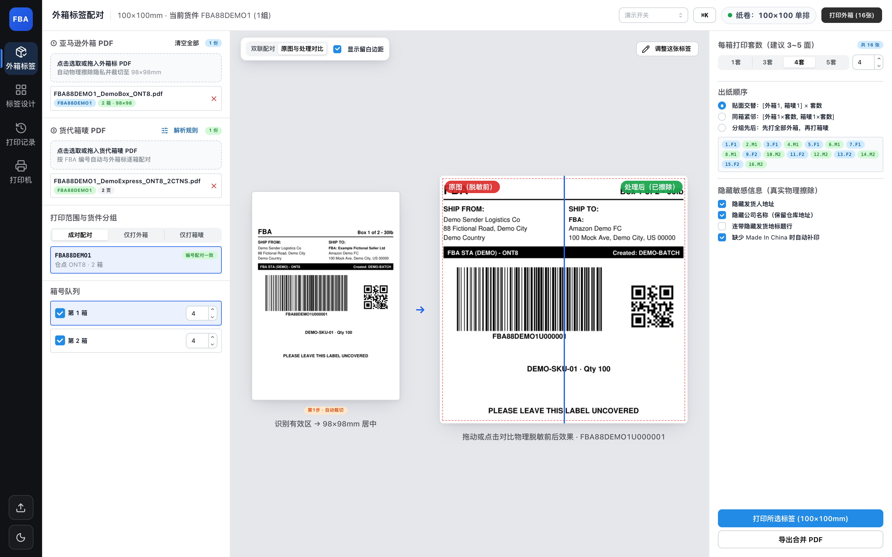
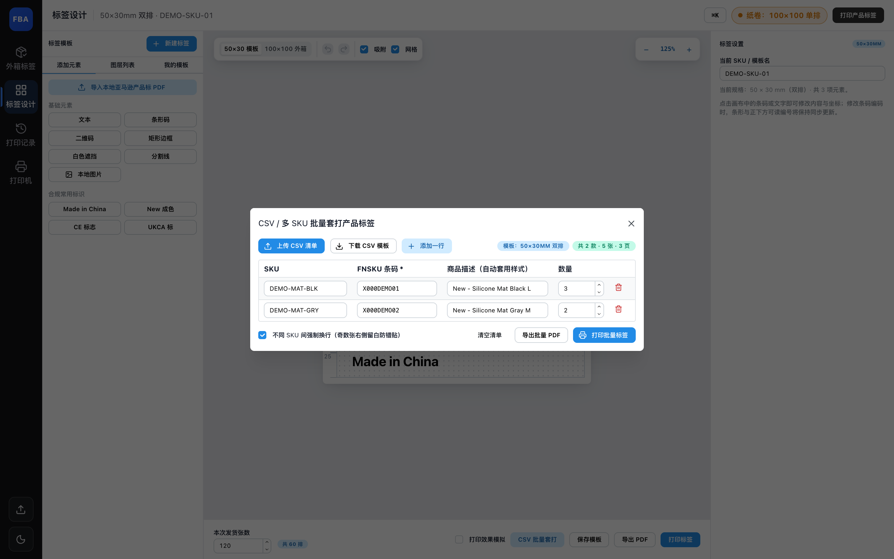
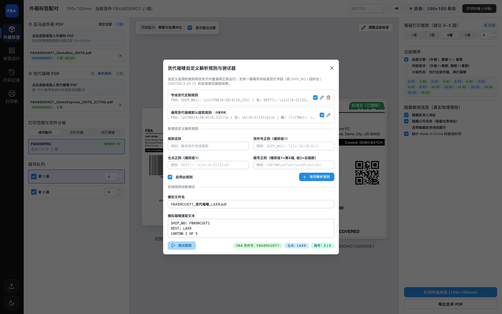
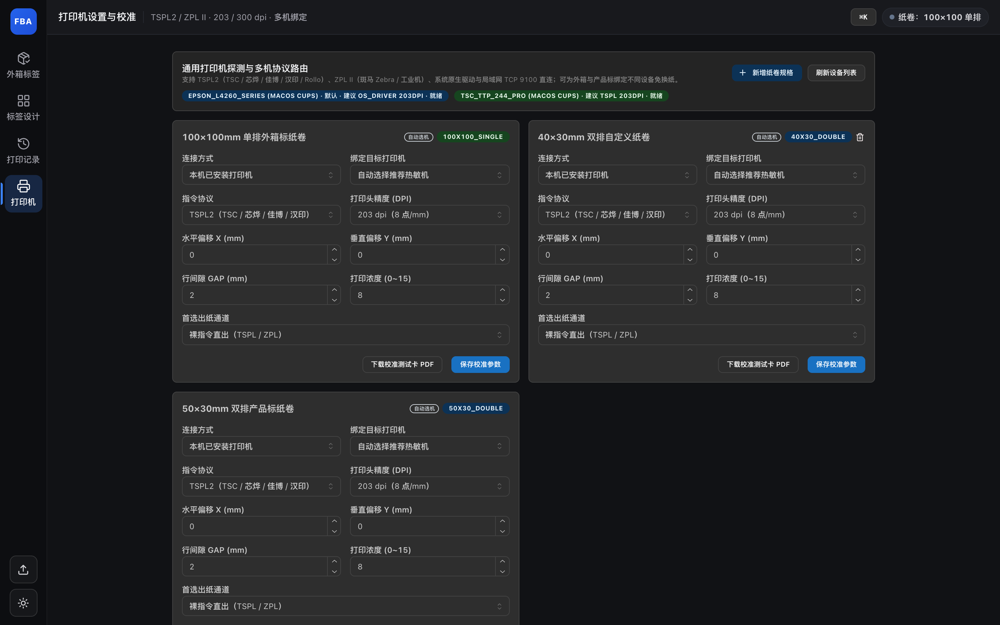

# FBA Label Studio — Local-First Amazon FBA Label Printer & Batch Workbench

<p align="left">
  <a href="README.md">简体中文</a> | <strong>English</strong>
</p>

<p align="left">
  <a href="https://github.com/GangdanLee/fba-label/releases"></a>
  <a href="LICENSE"></a>
  
  
  
</p>

**FBA Label Studio** is an open-source, **100% local-first** cross-platform desktop workbench (macOS & Windows) for **Amazon FBA & AWD box label processing (`100×100mm` / `100×150mm`)**, **privacy redaction**, **freight forwarder carton pairing (`FBA` / `STAR-` / `PO ID`)**, **50×30mm 2-up FNSKU label design & CSV batch printing**, and **native TSPL2 / ZPL II / TCP 9100 thermal printing**. Built as a privacy-respecting open-source alternative to manual PDF blackouts, screenshot workarounds, and proprietary tools like OpenLabel+ or BarTender.

> **TL;DR**: Everything runs locally on your machine with zero cloud uploads, zero accounts, and zero embedded seller data. Powered by Python (`FastAPI`, `PyMuPDF`, `zxing-cpp`) and `React 19` + `Mantine`.

---

## Live Screenshots

> **Privacy Note**: Every shipment ID (`STAR-DEMOAWD0001`, `FBA88DEMO1`), barcode, SKU, and address shown below was synthetically generated in an isolated sandbox. No real merchant or customer data exists in this repository.

### 1. FBA / AWD Box Label Processing & Carrier Pairing (`100×100` / `100×150mm`)

*Dual-channel PDF import for Amazon FBA / AWD box labels and freight forwarder marks: detects AWD fields (`STAR-`, `PO ID`, `SSCC`, official hubs like `IUTL`) while keeping company details intact by default, switches between `100×100mm` and `100×150mm` (`4×6`), pairs carrier labels by `PO ID` automatically, offers one-click `1+1`, and physically redacts standard FBA seller info.*

### 2. Before/After Redaction Comparison Slider & Auto-Crop Preview

*Step 1 strips excess whitespace from 4×6 sheets; Step 2 lets operators drag a split slider to verify vector-clean redaction via `apply_redactions` without damaging 1D or 2D barcodes.*

### 3. Visual FNSKU Canvas Designer & CSV Multi-SKU Batch Printing

*Import UTF-8 / UTF-8-BOM / GB18030 / TSV files, edit quantities inline, and batch-render using your active canvas layout (syncing Code128 barcodes, QR codes, and product titles while keeping compliance marks like `Made in China`). Supports **SKU-to-SKU row breaks** so odd-quantity 2-up runs leave the right column blank to prevent mislabeling.*

### 4. Custom Forwarder Carrier Regex Manager & Live Test Runner

*Handle non-standard carrier mark PDFs without touching code: define prioritized regex rules for Shipment ID, Warehouse Code, and Carton `X of Y`, and validate extraction immediately against pasted sample text.*

### 5. Multi-Protocol Printer Routing & Custom Roll Calibration (Dark Mode)

*Auto-detects installed printers and recommends protocol (`TSPL2` / `ZPL II`) and DPI (`203` / `300 dpi`), supports direct LAN `TCP 9100` printing, binds different printers to box vs. product rolls to eliminate roll swaps, and creates/deletes custom calibration profiles (`40×30mm 2-up`, `60×40mm`, `70×50mm`, `100×150mm`, or arbitrary sizes).*

---

## Why FBA Label Studio? (Comparison)

| Feature | FBA Label Studio (`v0.6.0`) | Manual PDF Editor + OpenLabel+ / BarTender | Online FBA Label Web Tools |
| :--- | :--- | :--- | :--- |
| **Data Privacy & Backup** | **100% offline local SQLite** + **1-click ZIP backup/migration** | Local but fragmented across machines | Uploads unredacted seller addresses/ASNs to remote servers |
| **Box Label Redaction** | **True text-stream removal (`apply_redactions`)**, `get_text()` = 0 hits | White overlay boxes leave hidden selectable text in the PDF | Usually rasterizes entire page, blurring barcodes |
| **4×6 Crop & Center Precision** | Auto-trims whitespace to `98×98mm` safe frame (`< 0.05 pt` tolerance) | Manual screenshots and trial-and-error scaling | Rigid fixed templates often clip multi-up layouts |
| **FBA + Carrier & SKU Grouping** | Pair by `shipment_id` or **cross-warehouse by SKU**, built-in FC dictionary, **persisted copy combos** | Tedious manual PDF flipping across warehouses | No cross-warehouse SKU sorting, separator pages, or carrier combos |
| **CSV Batch 2-Up & Auto-Draft** | Multi-encoding CSV/TSV + **odd-qty blanking** + **auto-saved editor drafts** | Complex mail-merge database setup | Rarely supports 2-up FNSKU + compliance templates |
| **Thermal Barcode Sharpness** | Native **TSPL2 / ZPL II** 1-bit bitmaps (`203/300 dpi`), integer-dot modules | OS driver raster scaling can blur narrow bars at 203 dpi | Generic PDF output only |
| **Licensing & Cost** | **Free & Open Source (`AGPL-3.0`)**, zero-install binaries available | Paid commercial licenses | Monthly SaaS subscriptions |

---

## Key Capabilities

1. **FBA / AWD Box Label Processing, Dual Size (`100×100` / `100×150mm`) & Semantic Redaction**
   - **Native Amazon AWD Support (`v0.6.0`)**: Detects `AWD` badges, `SSCC` (16–22 digits), `STAR-` shipment IDs, `PO ID`, `FNSKU`, and official AWD hubs (`IUTL`, `IUSJ`, `IUSP`, etc.). Preserves AWD labels verbatim by default (keeping company details intact and skipping `Made In China` stamping to protect bottom `SSCC` barcodes), offers an opt-in barcode-safe redaction toggle, verifies dual FNSKU + SSCC readability at 203 dpi, and warns on overweight (`>50 lbs`), excess units (`>150`), or `Mixed SKU` with a one-click **`1+1` (`Only one label per box`)** preset.
   - **FBA True Redaction & Dual-Size Export**: Supports both English and Chinese FBA layouts with vector-clean sender/company removal, selectable `100×100mm` or `100×150mm` (`4×6`) box paper output (persisted across restarts), and a 150+ FC/AWD whitelist.
2. **Multi-Key Pairing (`FBA` / `STAR-` / `PO ID` / Cross-Warehouse SKU), Persisted Copy Combos & No-Regex Rules**
   - **Shipment / PO ID / Cross-Warehouse SKU Grouping**: Groups by `shipment_id` (plus automatic cross-file `PO ID` matching for AWD carrier marks) or **By SKU (Cross-Warehouse)** with optional **separation prompt pages**, **UTF-8-BOM manifest CSV**, and **per-SKU ZIP bundles**.
   - **Flexible Independent Copy Combos (Auto-Persisted)**: Configure separate counts for FBA/AWD box vs. carrier labels (`2+1`, `2+2`, `4+2`, `4+4`, `1+1` presets + per-side & per-box overrides); paper size, grouping, separator toggle, ratios, order mode, and AWD redaction opt-in persist in SQLite (`GET/PUT /api/box/preferences`).
   - **Keyword-Based (No-Regex) Forwarder Parser**: Define forwarder rules by entering comma-separated label keywords or picking presets (including `AWD 头程箱唛规则`), alongside full regex mode and the live test runner.
3. **Vector Millimeter Label Designer (with Auto-Draft) & CSV Batch FNSKU Engine**
   - Built-in millimeter-accurate canvas editor (`Barcode1D` with synced human-readable text, `QR Code`, `Text`, `Rect`, `Line`, `Image`, compliance badges), `Amazon Product PDF` importer (normalizes `新品` → `New - ` and full-width punctuation), and **`localStorage` auto-draft protection** across accidental refreshes.
   - Batch-render hundreds of SKUs from UTF-8, UTF-8-BOM, GB18030, or TSV spreadsheets with per-element style inheritance and optional SKU-break blanking.
4. **Universal Printer Routing (`TSPL2` / `ZPL II` / OS Driver / `TCP 9100`) & Xprinter/Gprinter Hardening**
   - Emits crisp 1-bit `TSPL2` (`BITMAP`) and `ZPL II` (`^GF` ASCII hex) streams at `203` or `300 dpi` for TSC, **Xprinter (`XP-420B`, etc.)**, **Gprinter (`GP-1324D` / `GP-1134T`, etc.)**, 4BARCODE, Zebra, Rollo, and HPRT over macOS CUPS (`lp -o raw`), Windows `win32print` RAW/GDI, or direct LAN `TCP 9100` sockets.
   - **Xprinter / Gprinter Compatibility Hardening**: Automatically matches Chinese/English printer queues (including `XP420B` / `GP-1324D` and 300 dpi models), injects `REFERENCE 0,0` and `SET TEAR ON` to clear leftover third-party offsets, shifts negative X/Y offsets onto a clean white canvas, and exposes collapsible tuning (`DIRECTION 0/1`, `SPEED 1~8`, and `invert_bitmap` polarity compensation).
   - **One-Click Local ZIP Backup & Migration**: Export config-only or full-snapshot ZIP archives and restore via `merge` or `replace` with Zip Slip defense and automatic pre-import SQLite rollback backups.
   - **Custom Roll Profiles**: Add custom dimensions (presets for `40×30mm 2-up`, `60×40mm`, `70×50mm`, `100×150mm` single-row, or arbitrary W×H) and export `zxing-cpp`-verified calibration ruler PDFs.

---

## Supported Printers & Protocols

| Protocol / Channel | Compatible Thermal & Desktop Printers | Supported DPI | Transport |
| :--- | :--- | :--- | :--- |
| **TSPL2 Raw** | TSC (TTP-244 Pro, etc.), Xprinter (`XP-420B`, etc.), Gprinter (`GP-1324D` / `GP-1134T`, etc.), 4BARCODE, HPRT, Rollo | `203` / `300 dpi` | USB / OS Raw Queue (`lp -o raw` / `win32print`), TCP 9100 |
| **ZPL II Raw** | Zebra (ZD421, ZP450, GK888t, industrial models) | `203` / `300 dpi` | USB / OS Raw Queue, LAN TCP 9100 |
| **OS Native Driver** | Brother QL series, office inkjet/laser, or AirPrint-only queues | Auto | macOS CUPS PDF / Windows Win32 GDI |
| **Vector PDF Export** | Any printer, 3PL warehouse handoff, or batch archive | Lossless Vector | Direct download + SQLite reprint snapshot |

---

## Download & Quick Start (No Environment Setup Required)

1. Download the pre-built standalone archive for your OS from [**GitHub Releases**](https://github.com/GangdanLee/fba-label/releases):
   - **macOS (Apple Silicon `arm64`)**: Extract the ZIP and double-click `启动-FBA标签工作台.command` (on first launch if Gatekeeper warns about an unsigned app, Control-click → **Open**, or run `xattr -cr .` inside the extracted folder).
   - **Windows (`x64`)**: Extract the ZIP and double-click `启动-FBA标签工作台.bat` (if SmartScreen appears, click **More info** → **Run anyway**).
2. The launcher automatically picks a free local port and opens your default browser. Local settings and print history persist inside your user application data directory across upgrades.

---

## Build From Source & Offline Verification

```bash
# 1. Backend setup (Python 3.12 + uv)
cd backend
uv venv --python 3.12
# macOS / Linux:
uv pip install -e ".[dev]"
# Windows (with win32print RAW/GDI support):
# uv pip install -e ".[dev,windows]"

# 2. Frontend build (React 19 + TypeScript + Mantine 9)
cd ../frontend
npm install && npm run build

# 3. Launch locally (http://127.0.0.1:8000)
cd ..
./scripts/start_mac.command   # or scripts\start_win.bat on Windows
```

### Run Offline Test Suite (No Physical Printer Needed)
Every unit test synthesizes 100% fictional PDFs/CSVs on the fly, reverse-decodes generated `TSPL2` and `ZPL II` bitmaps, and runs automated **`zxing-cpp` barcode recognition**:
```bash
cd backend
.venv/bin/pytest -v
```

### Package Standalone Binary Release
```bash
cd backend && uv pip install -e ".[dev,build]" && cd ..
backend/.venv/bin/python scripts/build_release.py --version v0.6.0
backend/.venv/bin/python scripts/smoke_test_release.py release_out/FBA-Label-Studio-v0.6.0-macos-arm64.zip
```

---

## Frequently Asked Questions (FAQ)

**How does FBA Label Studio hide my `SHIP FROM` and company name without breaking barcodes?**  
Unlike drawing opaque white rectangles in a PDF editor—which leaves sensitive strings extractable underneath—FBA Label Studio uses `PyMuPDF` `apply_redactions(images=PDF_REDACT_IMAGE_NONE, graphics=PDF_REDACT_LINE_ART_NONE)` to physically purge text objects in the target regions while keeping vector lines and 1D/2D barcode imagery intact.

**Why do FNSKU barcodes from normal PDF printouts sometimes fail to scan at 203 dpi?**  
Generic OS print drivers resample vector bars onto a `203 dpi (8 dots/mm)` grid using fractional widths, causing adjacent bars to bleed together. Our generator enforces integer-dot module widths and protected quiet zones, coupled with live `dots_per_module` readability warnings in the designer.

**How does CSV batch printing handle odd quantities on 2-up (`50×30mm`) thermal rolls?**  
Enable **"Force row break between SKUs"** (enabled by default in the batch modal). When SKU A requests an odd count (e.g., 3 labels), the right slot on row 2 remains blank and SKU B starts cleanly on row 3, preventing warehouse staff from mixing labels across SKUs.

**Can I use non-TSC thermal printers such as Xprinter XP-420B, Gprinter, Zebra, Rollo, or HPRT?**  
Yes. FBA Label Studio natively encodes both **TSPL2** (TSC / Xprinter XP-420B / Gprinter GP-1324D & GP-1134T / 4BARCODE / HPRT / Rollo) and **ZPL II** (Zebra) at `203` or `300 dpi` over USB queues, Windows `win32print`, macOS CUPS, or direct LAN `TCP 9100`, with OS GDI/PDF fallback. It also injects `REFERENCE 0,0` & `SET TEAR ON`, shifts negative offsets onto a clean canvas, and offers collapsible tuning for direction, speed, and bitmap inversion.

**What if my freight forwarder uses a non-standard carton label format and I don't know regex?**  
Click **解析规则 (Parser Rules)** in the box workbench to use **Keyword Mode (No-Regex)** or apply one-click carrier presets by entering simple comma-separated field labels (with full regex mode also available), then validate extraction immediately in the live sample text tester.

**Where is my data stored, and how can I migrate templates/configs to another packing PC?**  
Strictly on your local drive (`~/Library/Application Support/FBA Label Studio/label_print.db` on macOS, `%LOCALAPPDATA%\FBA Label Studio\label_print.db` on Windows). Nothing leaves your machine. To back up or migrate across computers, open **打印机 (Printers) → One-Click Local ZIP Backup / Migration** to export a portable ZIP and restore via `merge` or `replace` (with automatic pre-import rollback backups).

---

## Community & Contact

Follow our WeChat Official Account **硅基妙妙屋** (ID: `Silicon_42`), focused on **AI-powered Amazon & cross-border e-commerce workflows**, covering Amazon Rufus & GEO optimization insights, AI Agent automation, data-driven product research, and practical open-source seller tools. Feel free to add the author's personal WeChat for usage discussions or printer compatibility feedback.

<table>
  <tr>
    <td align="center">
      <br />
      <strong>WeChat Official Account: 硅基妙妙屋</strong><br />
      <sub>ID: Silicon_42</sub>
    </td>
    <td align="center">
      <br />
      <strong>Personal WeChat</strong><br />
      <sub>Support / Feedback / Printer Compatibility</sub>
    </td>
  </tr>
</table>

---

## Privacy & License

- **Zero Real Data Policy**: All `*.pdf` and `*.db` files are ignored globally via `.gitignore`.
- **License**: Licensed under the **GNU Affero General Public License v3.0 (`AGPL-3.0`)**. See [`LICENSE`](LICENSE).
