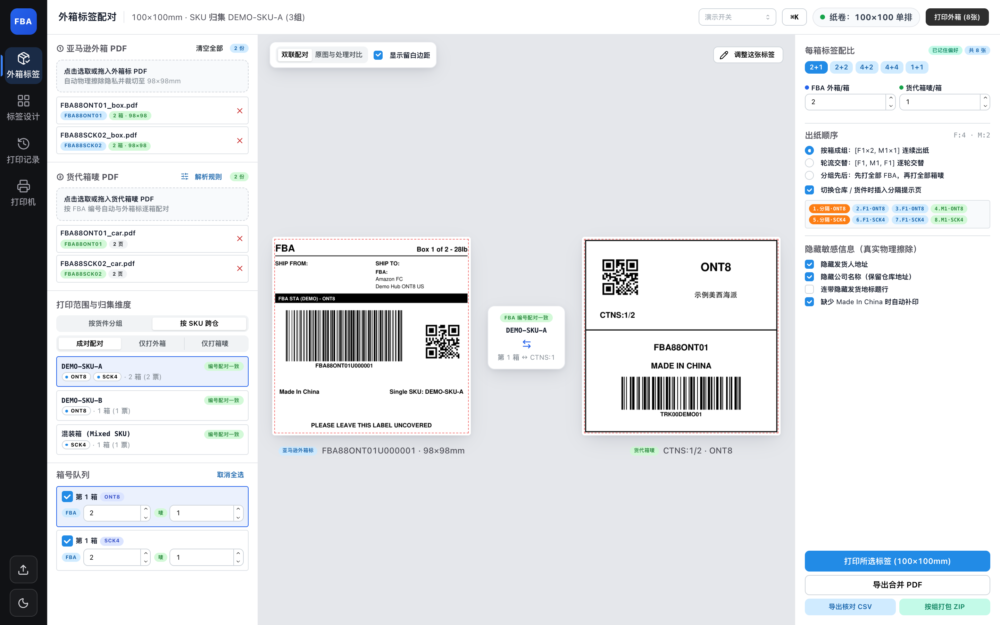
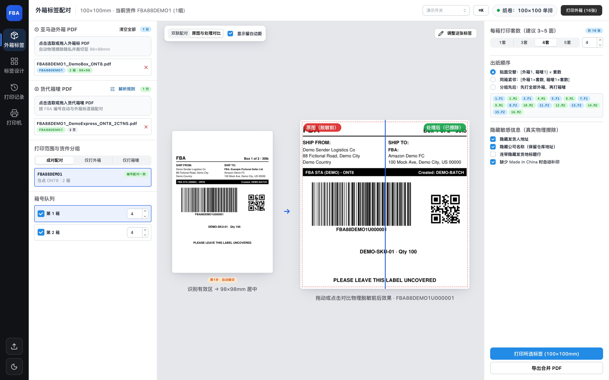
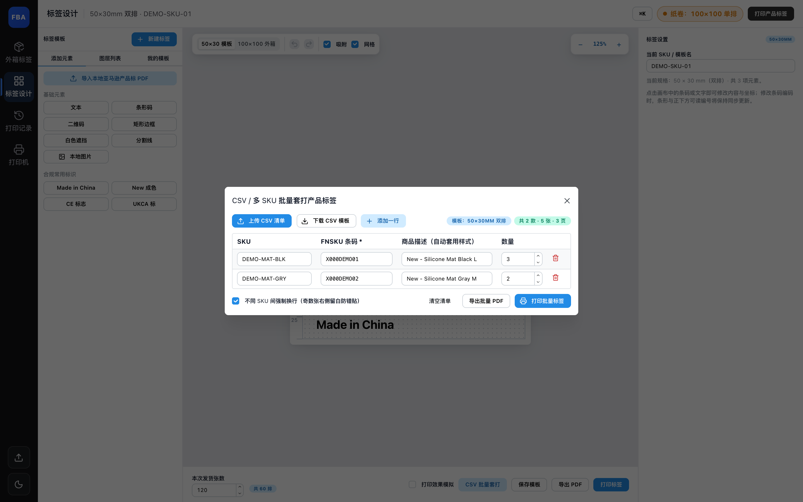
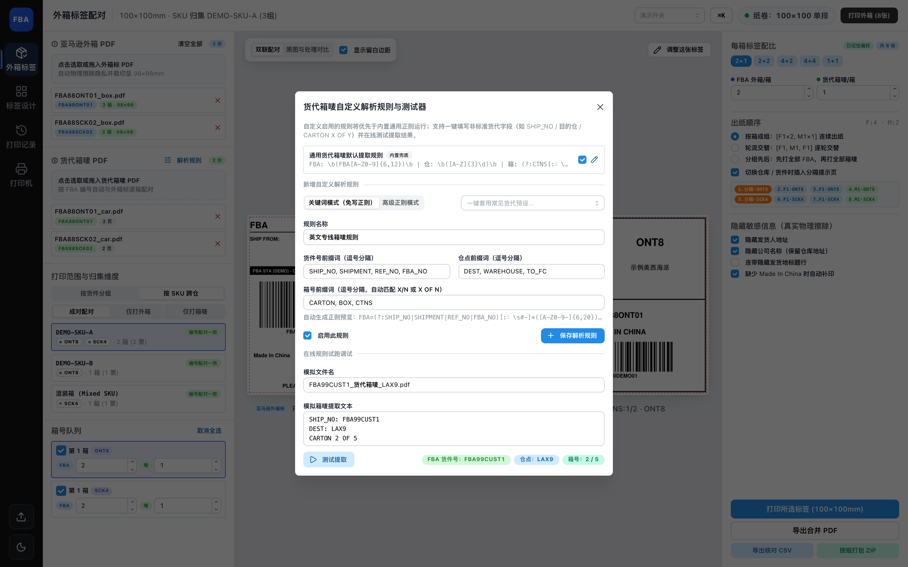
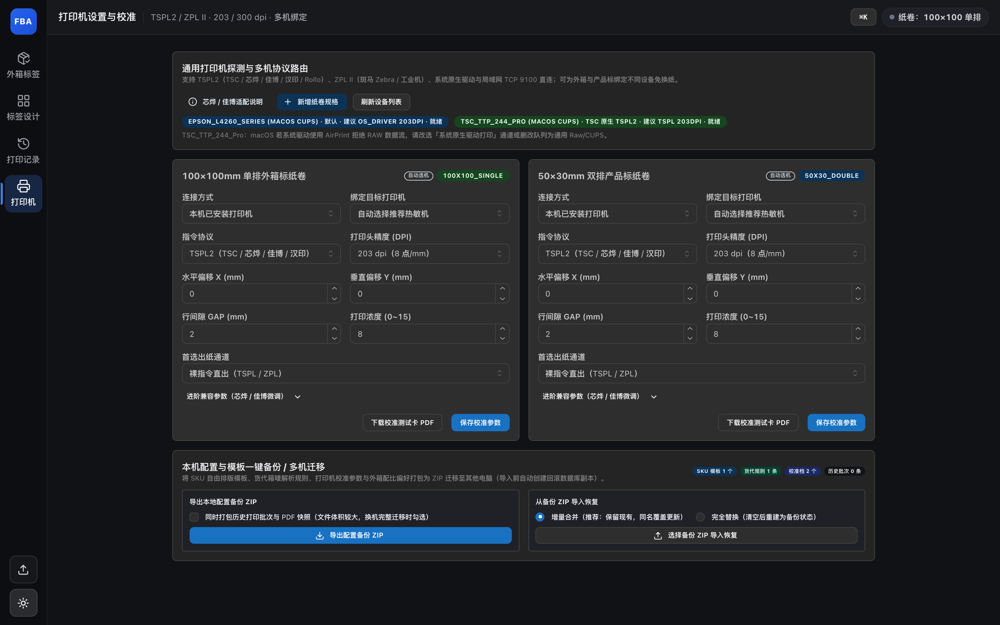

# FBA Label Studio · 亚马逊 FBA 一体化标签工作台

<p align="left">
  <strong>简体中文</strong> | <a href="README.en.md">English</a>
</p>

<p align="left">
  <a href="https://github.com/GangdanLee/fba-label/releases"></a>
  <a href="LICENSE"></a>
  
  
  
</p>

**FBA Label Studio** 是一款开源、**100% 本地离线运行**的跨平台（macOS / Windows）亚马逊 FBA 标签处理、自由排版设计与热敏直连打印工作台。它专为跨境电商卖家与海外仓/打包台打造，将 **FBA 外箱标签物理真脱敏与 `100×100mm` 自动裁切**、**货代箱唛按货件号防错配对**、**FNSKU 产品标签自由画布与 CSV 多 SKU 批量套打**，以及 **TSPL2 / ZPL II / TCP 9100 多机热敏直出**整合进同一本地桌面工具中，彻底替代“手工遮挡 PDF + 截图 + 通用设计软件逐张调整”的繁琐流程。

> **核心定位（TL;DR）**：免费开源的 OpenLabel+ / BarTender 跨境轻量替代方案。所有 PDF 解析、隐私擦除、条码生成与批量记录均在本机 SQLite 完成，**零账号登录、零云端上传、零真实商家数据内置**。

---

## 实机界面预览

> 说明：以下全部截图均采集自隔离运行环境，页面展示的货件号（如 `FBA88DEMO1`）、条码与地址信息均由程序实时合成，不含任何真实卖家资料。

### 1. 外箱标签物理脱敏与货代箱唛防错配对（`100×100mm`）

*双通道导入亚马逊外箱标与货代箱唛：自动擦除 `SHIP FROM` 发货人地址与 `FBA:` 公司名、居中裁切至 `98×98mm` 安全区、缺失 `Made In China` 时自动补印，并按 `shipment_id` + 箱号自动配对编排出纸队列。*

### 2. 脱敏前后卷帘对比与自动裁切示意

*第 1 步自动丢弃 4×6 整页多余留白并居中裁切，第 2 步支持左右拖动卷帘对比脱敏前后效果，底层 `apply_redactions` 物理删字且完整保护一维码与二维码图像。*

### 3. 标签设计器与 CSV 多 SKU 批量套打（支持双排防错贴留白）

*导入 UTF-8 / UTF-8-BOM / GB18030 / TSV 清单后自动套用画布模板样式，替换主条码、同步 QR 码与商品描述，并保留 `Made in China` 等合规元素；双排模式下支持「不同 SKU 间强制换行（奇数张右侧留白防错贴）」。*

### 4. 货代箱唛自定义正则规则管理与在线试跑器

*不同货代板式千差万别时，无需改代码即可在前端弹窗新增高优先级正则表达式，并在下方即时填入样本文本测试货件号、仓点与箱号提取结果。*

### 5. 通用多协议打印机路由与自定义纸卷校准（深色模式）

*自动探测本机打印队列并智能推荐协议（`TSPL2` / `ZPL II`）与精度（`203` / `300 dpi`），支持局域网 `TCP 9100` 网口直连；可为外箱与产品标绑定不同设备免换纸，并自由新增自定义纸卷规格及导出校准卡。*

---

## 为什么选择 FBA Label Studio？（能力对比）

| 核心维度 | FBA Label Studio (`v0.5.0`) | 手工 PDF 遮挡 + 通用标签软件 | 在线 FBA 标签处理网站 |
| :--- | :--- | :--- | :--- |
| **隐私安全性** | **100% 本地离线运行**，SQLite 仅存本机 + **一键 ZIP 备份/迁移** | 本地操作且换机难迁移 | 须上传含店铺公司名/地址的原始 PDF 至第三方服务器 |
| **外箱敏感信息处理** | **底层 PDF 文字流真擦除 (`apply_redactions`)**，`get_text()` 零残留 | 常见“盖白框”假遮挡，底层文本仍可复制/检索 | 多数按栅格图重压，易模糊条码 |
| **4×6 裁切与居中精度** | 全自动去除下半页留白，矢量保真等比居中 `98×98mm`（误差 `< 0.05 pt`） | 人工截图贴图，缩放易偏斜切边 | 固定模板适配，遇到拼版易切坏 |
| **外箱 + 箱唛与跨仓归集** | 按 `shipment_id` 隔离或**跨仓按 SKU 连续归集**、内置 FC 词典、**`FBA+箱唛` 配比持久记忆** | 纯靠多份 PDF 手工翻找，极易贴错仓或漏贴面 | 不支持跨仓 SKU 重排、换仓分隔页与货代配比联动 |
| **产品标 CSV 批量与草稿** | 多编码 CSV/TSV + **跨 SKU 强制换行留白** + 画布修改自动存草稿 | 手工绑定数据源配置复杂 | 几乎不支持自定义双排合规套打 |
| **热敏清晰度与指令协议** | 原生生成 `203 / 300 dpi` 1-bit **TSPL2 / ZPL II**、整数 dot 对齐条码 | 走系统驱动光栅缩放出纸，细条易糊粘连拒扫 | 仅输出通用 PDF |
| **授权与费用** | **完全免费开源 (`AGPL-3.0`)**，macOS / Windows 免环境包开箱即用 | 商业版按授权或年费订阅 | 按月/按次收费 |

---

## 核心特性详览

1. **外箱标签语义真脱敏与自动裁切（`100×100mm` 单排）**
   - 自动识别中英文互异左右分栏，物理擦除 PDF 底层文字流中的发货人地址与 `FBA:` 公司名称，完整保留亚马逊仓库地址。
   - 自动裁切多余空白区，矢量保真居中落版至 `98×98mm` 安全区；可选缺失 `Made In China` 时防压字自动补印；内置 **140+ 亚马逊高频 FC 仓点白名单**，有效过滤 `BOX1`/`CTN1` 等干扰编号。
2. **双维度防错配对（按货件 / 跨仓按 SKU 归集）、独立配比记忆 & 免正则规则**
   - **按货件或跨仓按 SKU 归集**：默认按 `shipment_id` 隔离分组并完成三维强校验；多仓库分仓混发时，一键切换 **「按 SKU 跨仓」** 自动识别 `Single SKU` / `SKU:`（混装箱独立隔离），将同款 SKU 跨多仓的标签连续归集、支持 **换仓/换单分隔提示页**、导出 **UTF-8-BOM 出纸核对明细 CSV** 及 **按组打包 ZIP**。
   - **灵活独立配比组合（自动记忆留存）**：支持「FBA 外箱 + 货代箱唛」分别设定打印张数（内置 `2+1`、`2+2`、`4+2`、`4+4`、`1+1` 一键预设，支持单边微调及按箱自定义覆写），常用配比、归集维度、分隔页、出纸顺序与脱敏规则自动持久化到本机 SQLite。
   - **免正则货代解析规则**：支持直接填写前缀词（`进仓号 / 目的仓 / 件数`）生成规则并一键套用常见货代板式预设，同时保留高级正则模式与在线试跑调试。
3. **矢量毫米画布标签设计器（含自动草稿）& CSV 多 SKU 批量套打**
   - 支持 `+ 新建标签`、导入亚马逊产品标 PDF（自动清洗中文成色 `新品` -> `New - ` 及全角标点）、条码与可读文本一体化同步编辑、203dpi 最小模块宽度实时预警，以及 **画布本地自动草稿保护**（刷新页面不丢失）。
   - 支持 UTF-8 / UTF-8-BOM / GB18030 / TSV 多编码 CSV 导入、下载标准模板、在线表格增改数量，并复用当前画布样式批量导出/打印。
4. **多协议打印机路由、芯烨/佳博兼容 & 一键 ZIP 备份迁移**
   - **兼容协议**：`TSPL2`（TSC / **芯烨 Xprinter XP-420B 等** / **佳博 Gprinter GP-1324D / GP-1134T 等** / 4BARCODE / 汉印 HPRT / Rollo）、`ZPL II`（斑马 Zebra 等工业机）、系统原生驱动（macOS CUPS / Windows GDI）以及局域网 **TCP 9100** 原始套接字直连。
   - **芯烨 / 佳博兼容加固**：自动识别 `XP420B`、`GP-1324D` 等中英文队列名并默认注入 `REFERENCE 0,0` 与 `SET TEAR ON` 消除残留偏移；负 X/Y 偏移转为白底画布像素安全平移，并提供可折叠进阶微调（`DIRECTION 0/1`、`SPEED 1~8`、`invert_bitmap`）。
   - **一键配置备份与多机迁移**：支持导出仅配置（模板/规则/纸卷校准/偏好）或含打印快照的 ZIP 备份，并在新电脑增量合并或覆盖恢复（含 Zip Slip 校验与导入前 `pre_import_*.db` 自动回滚留底）。
   - **自定义纸卷校准档**：内置 `50×30mm 双排` 与 `100×100mm 单排`，支持一键新建 `40×30mm 双排`、`60×40mm 单排`、`70×50mm 单排`、`100×150mm 单排` 或任意自定义尺寸，并动态生成 `zxing-cpp` 可扫校准测试卡。

---

## 支持的热敏打印机与协议速查

| 输出协议 / 通道 | 适用品牌与机台示例 | 支持精度 | 连接方式 |
| :--- | :--- | :--- | :--- |
| **TSPL2 裸指令** | TSC (TTP-244 Pro 等)、芯烨 Xprinter (XP-420B 等)、佳博 Gprinter (GP-1324D / GP-1134T 等)、4BARCODE、汉印 HPRT、Rollo | `203` / `300 dpi` | USB / 系统队列 (`lp -o raw` / `win32print`)、TCP 9100 |
| **ZPL II 裸指令** | 斑马 Zebra (ZD421 / ZP450 / GK888t 等)、ZPL 兼容工业热敏机 | `203` / `300 dpi` | USB / 系统队列、局域网 TCP 9100 |
| **系统原生驱动** | Brother / 办公激光喷墨或 AirPrint 限制 RAW 的打印机兜底 | 驱动自适配 | macOS CUPS PDF / Windows Win32 GDI |
| **高精矢量 PDF** | 任意打印机、外包打包点代打或归档留底 | 矢量无损 | 本地下载导出与历史快照补打 |

---

## 技术栈与项目结构

- **后端引擎**：Python 3.12 · FastAPI · Pydantic v2 · SQLite · PyMuPDF · Pillow · ReportLab · `zxing-cpp`
- **前端工作台**：React 19 · TypeScript · Vite · Mantine 9（原生 CSS Modules，零 Tailwind CSS）· Zustand
- **架构文档**：[`docs/DESIGN.md`](docs/DESIGN.md) ｜ **AI 检索索引**：[`llms.txt`](llms.txt)

```text
fba-label/
├── .github/workflows/release.yml   # macOS arm64 + Windows x64 自动打包发布流
├── backend/
│   ├── app/
│   │   ├── api/                    # FastAPI 路由：fnsku / box_labels / batches / hardware / system_backup
│   │   ├── engines/                # PDF 脱敏、仓点词典、货代解析、配对/SKU 归集、Code128 与批量渲染
│   │   ├── printers/               # TSPL2 / ZPL II 编码器、TCP 9100、CUPS / Win32 适配与扫码校验
│   │   └── models/                 # Pydantic 领域模型
│   └── tests/                      # 39 项 100% 合成数据离线单测与 zxing-cpp 扫码回归（含 test_v050_sku_group_and_backup.py）
├── frontend/                       # React + TypeScript + Mantine 桌面工作台源码
├── docs/                           # 架构设计与脱敏实机截图
└── scripts/                        # 一键启动脚本、PyInstaller 构建与冷启动冒烟验证脚本
```

---

## 下载发行版直接使用（免安装环境）

1. 前往 [**Releases 页面**](https://github.com/GangdanLee/fba-label/releases) 下载对应系统的免安装压缩包并解压：
   - **macOS (Apple Silicon arm64)**：解压后双击 `启动-FBA标签工作台.command`（首次若提示未签名，按住 `Control` 键点击 →「打开」，或在解压目录终端运行 `xattr -cr .`）。
   - **Windows (64-bit x64)**：解压后双击 `启动-FBA标签工作台.bat`（首次若遇 SmartScreen 提示，点击「更多信息」→「仍要运行」）。
2. 启动器自动分配空闲本地端口并打开浏览器，数据保存在系统应用目录（升级覆盖程序目录不丢失本地配置与打印记录）。

---

## 源码运行、打包与离线验证

### 1. 初始化环境并启动开发服务
```bash
# 初始化后端虚拟环境（基于 uv）
cd backend
uv venv --python 3.12
# macOS / Linux:
uv pip install -e ".[dev]"
# Windows (含原生 win32print RAW 支持):
# uv pip install -e ".[dev,windows]"

# 构建前端产物
cd ../frontend
npm install && npm run build

# 启动（默认访问 http://127.0.0.1:8000）
cd ..
./scripts/start_mac.command   # Windows 请双击 scripts/start_win.bat
```

### 2. 离线全链回归测试（无需连接实体打印机）
全部用例均由代码实时合成 100% 虚构中英文 PDF 与 CSV，并通过 `zxing-cpp` 对输出的 1-bit `203/300dpi` 位图执行机器扫码验证：
```bash
cd backend
.venv/bin/pytest -v
```

### 3. 本地打包独立分发压缩包
```bash
cd backend && uv pip install -e ".[dev,build]" && cd ..
backend/.venv/bin/python scripts/build_release.py --version v0.5.0
backend/.venv/bin/python scripts/smoke_test_release.py release_out/FBA-Label-Studio-v0.5.0-macos-arm64.zip
```

---

## 常见问题解答（FAQ）

**Q1：隐藏亚马逊外箱标上的发货地址与公司名，和直接用 PDF 阅读器画白色矩形覆盖有什么区别？**  
普通“画白块”只是视觉遮盖，发件人姓名、电话和公司信息依然明文留在 PDF 文字流中（他人可用鼠标选中复制或用脚本提取）。FBA Label Studio 调用底层 `PyMuPDF` `apply_redactions` 物理删除对应坐标内的文本流（同时保留条形码和二维码不被破坏），并用 `get_text()` 验证残留为零。

**Q2：为什么我之前的条码用 203dpi 热敏机打出来扫描枪老扫不上？**  
普通 PDF 直接交由系统驱动栅格缩放时，最窄黑条在 `203dpi (8 dots/mm)` 下容易变成 1.4 或 2.6 个像素，经二值化四舍五入后导致相邻条纹粗细失真或粘连。FBA Label Studio 在渲染条码时严格按整数 dot 取整并保障左右静区，并在画布内实时监控 `dots_per_module` 预警。

**Q3：双排 `50×30mm` 打印多款 SKU 时，如果上一款正好剩单数张怎么办？**  
在「CSV 批量套打」中默认开启 **「不同 SKU 间强制换行（奇数张右侧留白防错贴）」** 开关：当上一款 SKU 为奇数张（如 3 张）时，第 2 排右侧留白不排下一款，下一款直接从新的一排左侧开始，避免流水线贴标工人左右手混贴。

**Q4：我的热敏打印机不是 TSC TTP-244 Pro（例如芯烨 XP-420B、佳博 Gprinter），可以使用吗？**  
可以。软件全面支持发送标准 `TSPL2`（TSC / 芯烨 Xprinter XP-420B 等 / 佳博 Gprinter GP-1324D / GP-1134T 等 / 4BARCODE / 汉印 / Rollo）与 `ZPL II`（斑马 Zebra 等）裸指令，自动注入 `REFERENCE 0,0` 与 `SET TEAR ON` 消除第三方软件残留偏移，负 X/Y 偏移自动转为白底画布安全平移，并在「打印机设置 → 进阶兼容参数」中提供出纸方向 (`DIRECTION 0/1`)、打印速度与位图反色补偿开关，同时支持 `203` / `300 dpi`、局域网 `TCP 9100` 直连与系统原生驱动兜底。

**Q5：我的货代箱唛格式特别，不会写正则表达式怎么配置提取？**  
在外箱工作台点击货代箱唛栏旁的 **「解析规则」**，默认即可使用 **「关键词模式（免写正则）」**（直接填入如 `进仓号, 目的仓, 件数` 等前缀词或一键套用内置板式预设），也可切到高级正则模式，并用在线试跑调试器粘入样本文本立即测试。

**Q6：测试数据、打印快照和我的本地模板保存在哪里？怎么迁移到其他包装台电脑？**  
绝不会上传任何网络。所有数据全部写入您本机 SQLite（macOS 位于 `~/Library/Application Support/FBA Label Studio/label_print.db`，Windows 位于 `%LOCALAPPDATA%\FBA Label Studio\label_print.db`）。如需备份或复制到其他电脑，请在 **「打印机 → 本机配置与模板一键备份 / 多机迁移」** 中导出配置 ZIP 并在目标电脑上选择增量合并或覆盖导入即可（导入前会自动为目标电脑留底回滚副本）。

---

## 关注与交流

欢迎关注微信公众号 **「硅基妙妙屋」**（微信号：`Silicon_42`）——专注 **AI 赋能亚马逊与跨境电商实战落地**，持续分享 Amazon Rufus / GEO 算法拆解、AI Agent 自动化运营工作流、数据驱动选品分析与一线开源提效工具实践。使用过程中有任何建议、适配需求或问题反馈，也欢迎添加作者个人微信交流。

<table>
  <tr>
    <td align="center">
      <br />
      <strong>微信公众号：硅基妙妙屋</strong><br />
      <sub>微信号：Silicon_42</sub>
    </td>
    <td align="center">
      <br />
      <strong>作者 Morgan</strong><br />
      <sub>使用交流 / Bug 反馈 / 打印机适配</sub>
    </td>
  </tr>
</table>

---

## 隐私原则与开源许可

- **隐私原则**：仓库内绝不包含、不预置任何真实卖家标签、订单数据或 PDF 样本（全局 `.gitignore` 已屏蔽所有 `*.pdf` 与 `*.db`）。
- **开源协议**：本项目遵循 **GNU Affero General Public License v3.0 (`AGPL-3.0`)** 协议开源，详见 [`LICENSE`](LICENSE)。
